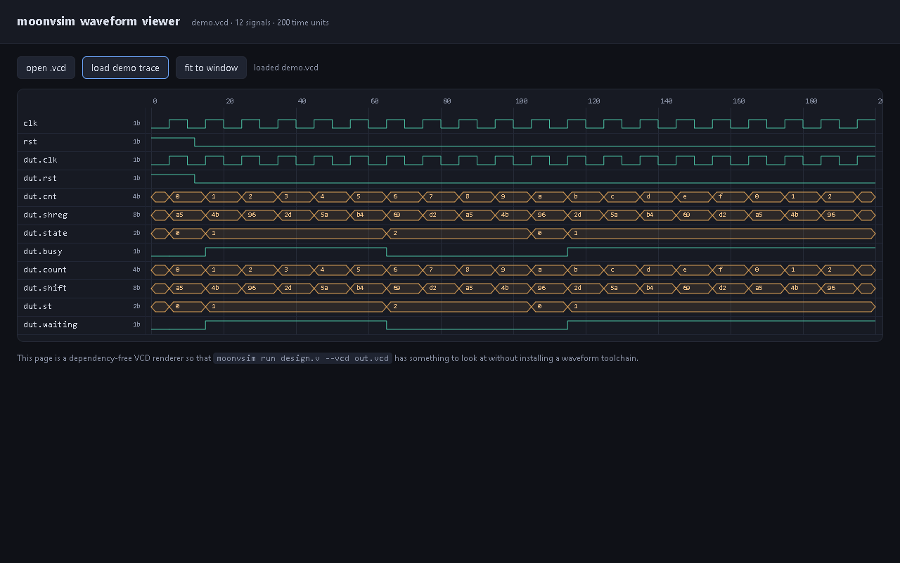

# moonvsim

A **MoonBit-native four-state event-driven RTL simulator for Verilog-2001**.

`moonvsim` reads a synthesizable Verilog subset plus a testbench, elaborates the
design hierarchy, and runs it as a discrete-event simulation. It writes
standard VCD traces, so every waveform viewer (GTKwave, Surfer, VS Code
WaveTrace) can open the results — and it is cross-checked against Icarus Verilog
on every check of every design in the conformance suite.



The viewer is a single dependency-free HTML file and is hosted at
**<https://lhmxgy.github.io/moonvsim/>** — press *load demo trace* to see a
counter, a shift register and an FSM produced by `moonvsim` itself.

```sh
$ moonvsim run examples/counter.v --vcd counter.vcd --max-time 120
t=100 q=9 carry=0
moonvsim: 4 nets, 4 processes, stopped at t=100
moonvsim: wrote counter.vcd
```

## Why this exists

MoonBit already has a Verilog *linter* (`moonbit-rtl`), VCD readers
(`moonbit-vcd`, `minivcd_mbt`), an analog SPICE solver
(`moonbit-circuit-solver`), Gerber tooling (`moonbit-gerberkit`) and an EtherCAT
master (`MoonECAT`), but no digital RTL execution engine. The linters say so
themselves: *"not a synthesizer, simulator, or replacement for a complete IEEE
Verilog implementation"*. `moonvsim` is that missing keystone — it turns a
design into events, not just diagnostics. The full keyword-by-keyword survey
behind that claim, including the projects that were checked and rejected, is in
[docs/ECOSYSTEM.zh.md](docs/ECOSYSTEM.zh.md).

## What is implemented

| Area | Status |
| --- | --- |
| Four-state bit vectors (0/1/x/z), 1..64 bits, x/z propagation | done |
| Verilog-2001 lexer (literals, comments, escaped ids, all operators) | done |
| Recursive-descent parser (modules, ports, params, statements, instances) | done |
| Elaboration: hierarchy, parameter override, port binding, widths, signedness | done |
| Stratified event scheduler with delta cycles and non-blocking assignment | done |
| Continuous assignments and combinational fixpoint | done |
| Blocking / non-blocking assignment, `if`, `case`, `for`, `while`, `repeat` | done |
| `#delay`, edge events, `always @(posedge/negedge/*)` | done |
| `$display`/`$write`/`$finish`, format specifiers | done |
| VCD writer (hierarchy, scopes, ids, value changes) | done |
| CLI: `run`, `--top`, `--vcd`, `--max-time` | done |
| Browser waveform viewer (no dependencies) | done |
| Differential conformance suite against Icarus Verilog | done |

### In scope

* Verilog-2001 synthesizable subset: `module`, `input`/`output`/`inout`,
  `wire`/`reg`/`integer`, parameters and localparams, `assign`, gate-free
  expressions, `always`/`initial`, `case`/`casez`-style equality, functions
  used as expressions are parsed but not executed.
* Testbench constructs: `initial`, `#delay`, `@(posedge/negedge)`,
  `$display`-family, `$finish`.

### Out of scope (deliberate, documented)

* SystemVerilog (`logic` is accepted as an alias for `reg` only).
* User-defined primitives, `specify` blocks, `fork`/`join`, `real`, timing
  checks, `force`/`release`, SDF back-annotation.
* Synthesis. This is a simulator, not a synthesizer.

## Conformance: 40 designs, 113 checks, 0 divergences

`conformance/run_conformance.py` runs every design twice — once through
`moonvsim`, once through Icarus Verilog 13.0 — and compares the `PASS`/`FAIL`
lines that the self-checking testbenches print. A divergence fails the run.

```
40 designs, 113 checks, 113 passed, 0 diverged, reference=iverilog
```

The suite covers arithmetic context widths, bitwise and reduction operators,
part/bit/indexed selects (`+:`/`-:`), concatenation and replication, logical
operators, `case`/`casex` behaviour with 4-state selectors, clocked counters,
edge-polarity semantics, FSMs, hierarchy (two levels, parameter override per
instance), declaration initialisers, signed arithmetic and mixed-signedness
comparisons, 64-bit wrap-around, x/z propagation, `$display` formats and
reset styles. See [conformance/REPORT.md](conformance/REPORT.md) for the
generated per-design table and [conformance/REPORT.json](conformance/report.json)
for machine-readable results.

Reproduce it with:

```sh
python conformance/run_conformance.py            # uses iverilog from PATH or the default path
python conformance/run_conformance.py --json conformance/report.json
```

## Quick start

Build the CLI:

```sh
moon build src/cmd --target native
# artifact: _build/native/debug/build/src/cmd/cmd.exe
```

Simulate a design and dump a waveform:

```sh
_build/native/debug/build/src/cmd/cmd.exe run examples/wave.v --top wave_tb \
    --vcd web/demo.vcd --max-time 200
```

Then open `web/index.html`, press **load demo trace**, and you get the
waveform view shown at the top of this file. The viewer is a single static
HTML file with no dependencies; drop any `.vcd` on it to inspect that instead.

## Examples

| File | Shows |
| --- | --- |
| `examples/counter.v` | clocked counter with carry, `posedge`, `$display` |
| `examples/alu.v` | combinational arithmetic and logic |
| `examples/hier.v` | module instantiation and port binding |
| `examples/traffic.v` | localparams, clocked `case`, combinational `case` |
| `examples/wave.v` | counter + shift register + FSM, used by the web demo |

## Design

```
src/value/      four-state bit vectors, arithmetic, comparisons, formatting
src/ast/        HDL syntax tree
src/lexer/      tokenizer
src/parser/     recursive-descent Verilog-2001 parser
src/elaborate/  hierarchy flattening, parameters, port binding, widths
src/sim/        evaluator, event scheduler, statement execution, state
src/vcd/        Value Change Dump writer
src/cmd/        command line interface
web/            dependency-free waveform viewer + demo trace
conformance/    40 self-checking designs and the differential runner
```

The four-state encoding keeps three bit planes per value (`val`, `unk`, `zed`)
in a 64-bit word, so a signal is one machine word and the arithmetic primitives
stay branch-light. Elaboration flattens the hierarchy into a single net table
with dotted names, which keeps the kernel free of tree walks. The scheduler is
stratified: run ready processes, commit non-blocking assignments, settle
combinational logic to a fixpoint, then propagate edges — a design that
oscillates is cut off after 1000 delta rounds rather than hanging.

More detail in [docs/ARCHITECTURE.md](docs/ARCHITECTURE.md).

## Tests

```sh
moon test                      # 33 unit tests across value/lexer/parser/elaborate/sim
python conformance/run_conformance.py
```

## Performance

`bench/run_bench.py` runs `examples/bench.v` (a 16-bit LFSR, a 32-bit
accumulator and a combinational datapath) for 20,000 clock cycles under both
simulators and requires them to agree on the final state:

| simulator | wall time | cycles / s |
| --- | --- | --- |
| moonvsim (native, release) | 492 ms | 40,637 |
| Icarus Verilog 13.0 | 70 ms | 287,154 |

Both print `bench done sum=26dfe118 prod=4c9b18d7`. The current engine walks the
AST and resolves identifiers by name, which costs roughly 7× against Icarus;
resolving operands to signal ids at lowering time (a bytecode pass) is the
first item on the performance roadmap. Correctness is the priority for this
milestone, and the throughput number is reported as measured rather than
hidden.

## Roadmap

* Bytecode lowering: resolve identifiers to signal ids once, so evaluation
  stops doing string work (targeted at closing the Icarus gap above).
* `casez`/`casex` with wildcard matching, `function`/`task` execution.
* Memories (`reg [7:0] mem [0:1023]`) and part-select writes on memories.
* Multi-clock domain warnings, X-checking lint pass.
* `--trace-vcd` streaming and a wasm-gc build of the viewer core so the
  browser can simulate directly instead of reading a dump.

## License

Apache-2.0. See [LICENSE](LICENSE).
